

  <a href="https://www.linkedin.com/in/rafaelrodriguespereira"></a>
  

  <a href="https://tcc-modern-lvc-arch.github.io/latinoware2026/"></a>
  <a href="https://github.com/tcc-modern-lvc-arch"></a>

  <a href="https://github.com/Raphonzius/poc-grpc"></a>
  <a href="https://github.com/Raphonzius/Demo-SpringSecurity6-JWT"></a>
  <a href="https://github.com/Raphonzius/spring-and-vue"></a>
  <a href="https://github.com/Raphonzius/cachyos-setup"></a>

  <a href="https://github.com/Raphonzius?tab=repositories"></a>
  <a href="https://github.com/Raphonzius?tab=repositories"></a>

  <a href="https://www.linkedin.com/in/rafaelrodriguespereira"></a>
  <a href="https://www.linkedin.com/in/rafaelrodriguespereira"></a>

  
  

